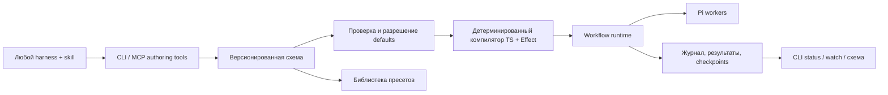

# Предложение архитектуры

Статус: исходный черновик; ответы получены 2026-09-08. При расхождениях действуют
[зафиксированные решения](decisions.md), в частности: граф до запуска, отсутствие
лимитов и human gates по умолчанию, oracle вне текущей реализации.
Это собственный проектный вывод; подтверждённые свойства сторонних систем вынесены
в исследования. Конкретные версии зависимостей выбираются после проверки API.

## Основная граница

Harness даёт агенту skill и доступ к CLI либо MCP. Агент описывает намерение блоками,
портами, связями и настройками. Pi выполняет агентные задачи. TypeScript + Effect
управляет жизненным циклом исполнения. Состояние workflow принадлежит движку.

Оркестрацию нельзя прятать в промпт «сам повторяй, пока хорошо»: review, condition,
loop и join должны быть исполняемыми частями схемы. Сгенерированный TS — проверяемый
артефакт компилятора с source map до block ID. Одна лишь сериализация JSON
в `runGraph(json)` не доказывает требование полноценной машинной компиляции.

## Четыре разных сущности

| Сущность | Что хранит | Почему отдельно |
| --- | --- | --- |
| Role definition | Промпт, defaults модели/thinking, доступные tools/skills, schema результата | Повторно используется в разных графах |
| Node definition | Роль, входы, overrides, policies, порты | Описывает место в схеме |
| Activation | Конкретный вызов узла, iteration/item/attempt, snapshot inputs | Один узел запускается много раз в цикле/fan-out |
| Pi session | История диалога и работающий runtime агента | Жизнь контекста не должна подменять состояние графа |

Предложение: отдельная pi-сессия на активацию по умолчанию; явная политика
`per-node` для сохранения контекста исполнителя через review-loop. Одну сессию
нельзя одновременно назначать независимым активациям. Runtime хранит session IDs
и управляет освобождением ресурсов. Весь workflow не обязан быть ещё одним pi-агентом.

## Два каталога примитивов

Агентные роли и управляющие операторы не следует смешивать.

| Роль | Назначение | Предложенные defaults / выход |
| --- | --- | --- |
| general | Задача без специализации | Balanced model alias; typed result + artifacts |
| researcher | Сбор данных с источниками | Read + настроенные research tools; claims/evidence/unknowns |
| planner | План с зависимостями и критериями | Read-only; steps, risks, acceptance checks |
| implementer | Изменения в проекте | Coding tools; patch/commit, tests, unresolved items |
| reviewer | Проверка конкретной версии артефакта | Read-only; approve/changes_requested/inconclusive + findings |
| verifier | Проверка критериев и фактов | Доступ к разрешённым проверкам; pass/fail/unknown + evidence |
| oracle | Независимый эксперт по трудному вопросу | Strong model alias; analysis, assumptions, recommendation |
| synthesizer | Объединение выводов | Read-only; результат с происхождением утверждений |
| arbiter | Разрешение разногласий | Strong alias; решение и объяснение по явной policy |
| orchestrator | Предложение/расширение плана графа | Graph tools в ограниченной области; typed graph patch |

Число и детализация ролей уточняются на сквозных сценариях. Oracle пока означает
дорогого эксперта, отдельно от arbiter и verifier; пользователь может уточнить.
Draft/preset может содержать portable alias модели. Операция подготовки исполнения
разрешает alias из локального каталога и создаёт frozen plan с provider/model/thinking;
compile работает именно с этим plan, start проверяет его доступность без тихого
повторного разрешения. На другой установке preset может потребовать нового plan;
inspect показывает разницу. Не надо зашивать выдуманные model IDs.

Управляющие блоки: start/end, branch, loop, map, parallel/join, review-gate,
subworkflow, human-gate, transform, artifact, детерминированная проверка командой.
Retry/timeouts относятся к execution policy, а не означают редакторский цикл.
Transform и branch используют маленький валидируемый expression AST: ссылки на
поля, сравнения, логические операции, коллекции. Произвольный JS не требуется.

## Семантика связей и циклов

Разделить control edges (когда запускать) и data bindings (что передать).
Иначе выход condition и готовность данных будут неявно конфликтовать.
Нужно различать три уровня: run state (например running/paused/completed/failed),
activation state (scheduled/running/succeeded/failed/cancelled/interrupted) и domain
outcome (например approve/changes_requested/inconclusive у review либо exhausted
у loop). Успешно выполненный reviewer может вернуть changes_requested; это не
инфраструктурная ошибка. Отмена или ошибка не превращается в approve и не
отфильтровывается как пустота. Точные enum будут закреплены в схеме.

Предпочтительная модель — граф со структурными областями loop/map/parallel.
Обратное ребро внутри loop адресует новую итерацию. Валидатор может распознавать
обычное нарисованное пользователем обратное ребро и предлагать оформить loop;
не поддерживаемые неоднозначные циклы должны объясняться, а не игнорироваться.
Пользователь по-прежнему собирает блоки и стрелки; backend нормализует структуру.

Каждая активация имеет ключ `(run, revision, node, scope, iteration, item, attempt)`.
Join собирает результаты только своего scope/iteration. Map фиксирует исходный
список и стабильные item IDs. Порядок завершения не меняет порядок выходов.
Ошибки child явно обрабатываются fail-fast/collect/quorum политикой.

Review-gate связывает approve с хешем/commit проверенного артефакта и версией
критериев. Изменения после review делают прежнее approve неприменимым.
Ошибку модели нельзя считать отрицательным голосом по качеству; `inconclusive`
обрабатывается отдельно. Правила кворума описываются данными в блоке gate.

Loop задаёт stop predicate, предел итераций и no-progress policy. Исчерпание
лимита возвращает paused/exhausted, а не success. Значения лимитов пока открыты.

## Authoring API

Предложенные операции общего сервиса, доступные одинаково из CLI и MCP:

- `catalog.list/describe`: роли, операторы, schema, модели, skills, tools.
- `workflow.create/inspect`: создать draft, посмотреть разрешённые настройки.
- `workflow.patch`: атомарная пачка add/update/remove node, connect/disconnect;
  `expectedRevision` защищает от потери конкурентных изменений.
- `workflow.validate/compile`: объяснимые ошибки по block ID, compiled TS,
  manifest зависимостей и plan/hash.
- `run.start/status/events/pause/resume/cancel`: durable run ID и управление.
- `run.inspect`: inputs/outputs/evidence/usage конкретной активации.
- `preset.save/list/show/instantiate`: сохранение схемы и настроек из run.

CLI принимает JSON через файл/stdin, возвращает стабильные JSON-объекты и exit codes.
Длинный запуск возвращает run ID; transport connection не владеет worker lifetime.
Результаты больших исследований хранятся как артефакты и загружаются адресно.
В skill должны быть готовые recipes authoring: review-loop, map→verify→synthesize,
parallel reviewers→gate, nested workflow. Агент не пишет runtime-код.

## Изменение графа во время запуска

Не решено, обязательно ли это для первой версии. Если требуется, orchestrator
подаёт typed patch, валидатор проверяет его и публикует новую revision на checkpoint.
Уже выполненные активации остаются в истории старой revision. Изменение входов,
настройки модели или критериев требует явной инвалидизации зависимых результатов.
Нельзя менять выполняющийся node незаметно. Чистый fan-out по найденным данным
не требует произвольной мутации topology и должен работать независимо.

## Исполнение, сохранение и восстановление

Предложение для одной машины: SQLite для транзакционных run records, activations,
leases и events; файлы для content-addressed artifacts и pi transcripts.
Подключение удалённых workers возможно через отдельный PiWorker service, но
распределённый scheduler до ответа пользователя не считается требованием.

Effect обеспечивает композицию, typed failures, scoped resource cleanup,
concurrency и cancellation. Наличие Effect само по себе не доказывает durable
recovery. Выбор между проверенным Effect workflow backend и собственным небольшим
журналируемым scheduler требует технического spike на pinned версиях.

Checkpoint фиксирует итог активации и готовность следующих шагов транзакционно.
При restart engine сопоставляет leases с реальными процессами/сессиями.
Неопределённый исход внешнего эффекта — отдельное состояние `interrupted/unknown`.
Автоматический повтор допускается по явно заданной idempotency/recovery policy.
Нельзя обещать exactly-once для произвольного shell, редактирования файлов или API.

Пауза запрещает запуск новых активаций; отдельно задаётся, ждать ли активные или
прерывать их. Cancel распространяется на дочерние workflow и pi workers; статус
cancelled выставляется после подтверждения остановки. Учёт использования
сохраняется и для неуспешных попыток. Недоступную стоимость показывать unknown.

## Контекст и permissions

Контекст роли: контракт задачи + явные входы + выбранные артефакты + локальная
история согласно session policy. Доступ ко всему транскрипту соседей необязателен.
Независимый reviewer по умолчанию читает артефакт и acceptance criteria, а не
самооценку исполнителя; findings доступны implementer на следующей итерации.

Эффективные права вычисляются как пересечение installation policy, run grant
и node request. Overrides не могут расширить полномочия поверх run grant.
YOLO может быть явным профилем владельца установки; это не свойство импортируемого
preset. Предложенные профили: read-only, workspace-write, isolated-exec, unrestricted.
Проектный ресурсный loader и executable extensions входят в модель прав.

Ограничение списка tools — реальная capability boundary, но read-only prompt,
ограничение cwd или worktree не являются ОС sandbox. Для запуска произвольных
недоверенных команд нужна отдельная isolation backend. UI/doctor обязан честно
показать какой уровень реально действует, не создавать ложное обещание защиты.

Git-изоляция — отдельная policy: shared workspace с последовательным writer либо
worktree на ветку выполнения и явный integrator. Review должен ссылаться на точную
версию. Merge conflict маршрутизируется как задача с контекстом, а не исчезает.

## Пресеты и наблюдаемость

Preset сохраняет graph schema + resolved role/prompt/skill snapshots и hashes +
model policy + declared inputs + compiler/runtime compatibility. Ссылки и хеши
без сохранённого содержимого не обеспечивают воспроизводимость: snapshots входят
в экспортируемый bundle либо извлекаются из content-addressed store; отсутствие
нужной версии — явная ошибка. Credentials,
run grants и рабочие transcripts в обычный preset не попадают. Сохранение из
удачного run должно фиксировать фактически применённые настройки, а не заново
подтягивать изменившиеся defaults. Глобальная и проектная библиотеки могут сосуществовать.

`watch` рисует рёбра и статусы блоков, iteration, child counts, длительность и usage.
Для вложенного графа — свёрнутый scope с drill-down. Events имеют монотонный sequence
и доступны после disconnect, без необходимости перечитывать весь лог. Схема и
status читают одну модель run; рисунок не вычисляет состояние самостоятельно.

## Следующие шаги

1. Собрать исследования и ответы; выбрать сквозной пример и уточнить открытые решения.
2. Проверить pinned pi/Effect API небольшим техническим spike с cancel/recovery.
3. Реализовать schema + catalog + atomic graph tools + compiler.
4. Реализовать журналируемый runtime и pi worker adapter с meaningful tests.
5. Добавить CLI/MCP, skill, setup/doctor, presets и terminal watch.
6. Пройти сквозные проверки из requirements.md с настоящими моделями и коммитить
   законченные изменения. Не заменять это mock-only демонстрацией.
