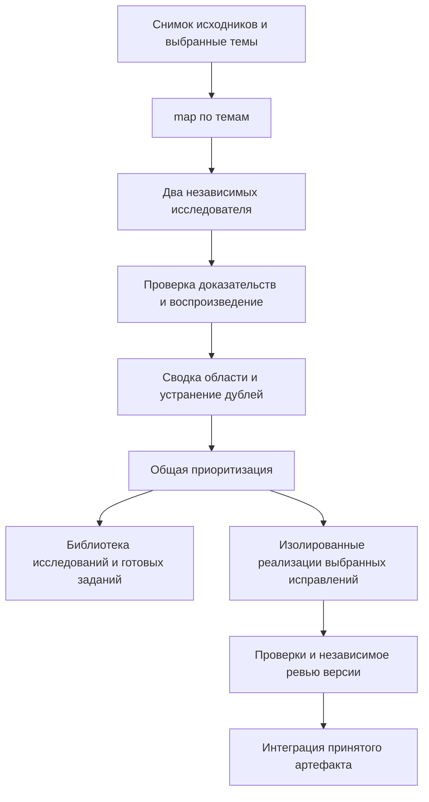

# Программа работы Grok: dynamicwf, remote-pi и соседние инструменты

Дата: 18 сентября 2026, Europe/Moscow. Подписка, по словам пользователя, заканчивается завтра; точное время неизвестно.

Статус: **только план**. Пользователь попросил пока всё продумать. Этот документ не запускает воркфлоу и не означает, что перечисленные возможности уже реализованы или проблемы подтверждены.

Порядок запуска, отделение работающего движка от изменяемого проекта, изоляция исполнителей и восстановление: [операционный план кампании](grok-campaign-operations-2026-09-18.md).

Цель: превратить оставшийся доступ к Grok в проверенные знания, воспроизводимые проверки, законченные улучшения и подробные задания на будущее. Каталог содержит **180 заданий по 18 направлениям**. Это запас полезной работы, а не обещание выполнить всё за сутки и не требование найти 180 багов.

## На чём основан план

Просмотрены актуальные исходники, структура тестов, инструкции и документация двух локальных проектов. Полные тестовые наборы в ходе составления этого плана не запускались. В обоих репозиториях есть незакоммиченные изменения; перед будущим запуском нужен снимок именно рабочего состояния, а не только HEAD.

| Наблюдение | Основание | Следствие для программы |
| --- | --- | --- |
| dynamicwf использует pi SDK 0.85.1; локальная команда pi сообщает 0.85.0 | package.json dynamicwf; фактический `pi --version` | Сравнить два пути интеграции на одинаковых сценариях; разница версий сама по себе не доказывает поломку. |
| remote-pi требует ровно pi 0.85.0 и отдельно проверяет версии зависимостей | ../remote-pi/lib/pi-runtime.mjs, release-manifest.json | Подготовить проверяемый порядок обновления клиента, SDK и Linux runtime. |
| В dynamicwf уже выполнен переход на встроенный xAI; в remote-pi остаётся условно подключаемый адаптер старого плагина | src/model-runtime.ts; ../remote-pi/lib/xai-adapter.mjs и lib/pi-runtime.mjs | Проверить необходимость оставшейся ветки и миграцию сохранённых профилей. Наличие файла не доказывает, что эта ветка сейчас используется. |
| В документации dynamicwf есть подтверждённое расхождение с кодом | docs/service.md говорит, что reconciliation tool ещё нет; src/service.ts экспортирует run.reconcile | Проверка документации должна сверять утверждения с кодом и сценариями, а не переписывать старые отчёты. |
| Неинформативный fallback ошибки ещё существует | src/pi-worker.ts: Pi assistant turn failed or was aborted; remote-pi/lib/bridge.mjs обобщает ошибки | Исследовать передачу полезной причины без вывода чувствительных тел запросов и ответов. |
| В dynamicwf уже есть учёт токенов, task lineage, recovery, finish/await, worktree/integrate и постоянный dashboard | src/, актуальные docs/usage.md, graph-contract.md, browser-ui.md | Проверять качество и полноту существующего, не предлагать заново уже сделанное. |
| В remote-pi уже есть durable RPC IDs, reconnect, самостоятельные jobs и изолированный Linux fixture | remote/rpc.py, remote/jobs.py, tests/integration/README.md | Искать пограничные случаи и недостающие доказательства, а не приписывать проекту отсутствие этих механизмов. |
| diagram-design уже изучался, но отчёт датирован 10 сентября | docs/diagram-design-review.md | Сверить старые рекомендации с сегодняшним renderer; исторический дефект не считать текущим. |

HEAD при исследовании: dynamicwf `1ee8fab928245804e20b500eca22e80d1fef49f7`; remote-pi `341f67a8e93eed8113186be2486b5e40fde43780`. Оба checkout содержат изменения поверх HEAD.

## Что должно остаться после подписки

1. Реестр подтверждённых дефектов с минимальным воспроизведением и независимой проверкой.
2. Исполнимые regression, integration и fault-injection fixtures, пригодные для повторения без платных модельных вызовов там, где модель не является предметом проверки.
3. Набор законченных небольших исправлений с проверенной версией артефакта и понятной историей интеграции.
4. Исследовательское досье: источники, альтернативы, опровергнутые гипотезы и причины решений.
5. Спецификации будущих функций: пользовательский сценарий, границы, интерфейсы, миграция и критерии приёмки.
6. Прототипы важных интерфейсов и диагностических инструментов.
7. Набор реальных заданий для оценки качества агентов и самого dynamicwf.
8. Библиотека проверенных рецептов workflow и руководство для нового агента.

Число страниц, замечаний и израсходованных токенов не является критерием приёмки. Допустимый результат исследования — «проверено, проблемы не найдено» с описанием того, что именно проверялось.

## Как распределить работу

Основная модель будущей кампании — встроенный `xai/grok-4.6` с `xhigh`, если эта комбинация по-прежнему есть в каталоге при подготовке. Перед запуском проверить каталог; не подменять молча модель или thinking. Другие подписки для этой программы не обязательны.

Для сложных тем назначать **двух независимых исследователей**, а затем отдельного проверяющего. Первый изучает реализацию и реальные сбои. Второй получает исходное задание без первого отчёта и ищет альтернативные объяснения. Проверяющий получает оба результата, пытается опровергнуть выводы и, где возможно, воспроизводит проблему. Одинаковая модель в разных сессиях всё ещё имеет общие слабости; тест и внешнее доказательство важнее голосования.

Простые задачи не требуют трёх агентов: исправление одного документального расхождения или экспорт отчёта можно проверить обычной командой. Дополнительные агентские вызовы полезны там, где дают новый взгляд, эксперимент или вариант решения.

Агрегация идёт по областям, затем между областями. Полные исходные результаты сохраняются отдельно: итоговый агент получает структурированные выводы и ссылки, а не весь массив логов в одном контексте. В каждом пакете должен быть промежуточный завершённый результат, чтобы окончание подписки не обнулило большую незавершённую работу.

Параллельность выбирается по измеренной пропускной способности провайдера и машины. Большая подписочная квота не доказывает доступность любого количества одновременных запросов. 429, latency, число активных запросов и ошибки учитываются отдельно от токенов. Не вводить произвольные бюджеты токенов, циклов и времени в граф; авторить явные условия завершения. Ошибки с неопределёнными эффектами не повторять автоматически.

## Первая волна: 24 темы

Эти темы я бы взял первыми. Для каждой предусмотрены два независимых исследования и проверка: **72 агентских задания плюс сводки**. Это структура предлагаемой работы, не уже запущенные процессы.

| Пакет | Задания | Почему сначала |
| --- | --- | --- |
| Надёжность исполнения | B01, B02, B03, G01 | Повторные эффекты, потеря результата и неверная приёмка напрямую портят работу. |
| Grok и наблюдаемость | C01, C03, C09, D01 | Проверить реальный native путь, изображения и способность объяснить остановку. |
| Удобство dynamicwf | E01, E03, F01, F02 | Запуск с первого раза, восстановление без путаницы, читаемый большой граф. |
| remote-pi под сбоями | I01, I02, K01, L01 | Потеря связи, дубли, процессные границы и локальная авторизация. |
| Совместимость и интерфейс | J01, L03, M01, D03 | Сессии, миграция xAI, версия runtime и честный учёт токенов. |
| Будущее и проверка качества | N01, O01, R01, G02 | Архитектура совместного запуска, внешние решения и проверка независимости ревью. |

Первые подтверждённые небольшие исправления могут проходить реализацию и проверку, пока остальные темы ещё исследуются. Не нужно ждать завершения всех 180 исследований для получения полезного результата. Переход к такой работе — после отдельного решения пользователя запускать кампанию.

## Каталог заданий

В каждой строке: вопрос или действие → обязательный результат. Метка ★ обозначает первую волну. Реализации ниже являются кандидатами: сначала проверить необходимость и состояние текущего кода.

### A. Семантика графа и качество плана

Опорные файлы: src/graph.ts, expressions.ts, compiler.ts, execution-plan.ts; tests/graph.test.ts, compiler.test.ts, expressions.test.ts.

| ID | Задание и результат |
| --- | --- |
| A01 | Найти планы, проходящие validate, но неизбежно падающие до полезной работы; собрать минимальные графы и разделить статически обнаружимые ошибки и ошибки данных. |
| A02 | Проверить ссылки на будущие и предыдущие посещения узлов, lazy select и exists; составить таблицу корректных и некорректных feedback-сценариев. |
| A03 | Проверить порядок условных рёбер, fallback и конфликтующие условия; предложить объяснения валидатора с конкретным путём исправления. |
| A04 | Составить матрицу end, finish, accepted, rejected, inconclusive во вложенных графах; проверить, что локальное решение не подменяет принятие всей задачи. |
| A05 | Проверить map на пустом массиве, перестановках завершений, вложенных map и частичных ошибках; сохранить контрпримеры порядка и изоляции контекста. |
| A06 | Проверить parallel/collect и сведения о неуспешных детях; показать, где ошибка может ошибочно превратиться в пустой успешный результат. |
| A07 | Исследовать статическое предупреждение о неполных входных данных узла; подготовить минимальный анализатор без запрета корректных guarded loops. |
| A08 | Разобрать prepare на фоне изменения draft, skill, cwd и модели; документировать, что именно замораживается и что остаётся внешним состоянием. |
| A09 | Проверить outputSchema на неоднозначных типах, неизвестных keywords и слишком больших ошибках; предложить диагностические fixtures. |
| A10 | Спроектировать dry-run плана с синтетическими результатами узлов; определить, что он доказывает, и сделать прототип без вызовов модели. |

### B. Исполнение, остановка и восстановление

Опорные файлы: src/supervisor.ts, run-controller.ts, run-runtime.ts, reconciliation.ts, recovery-inspection.ts, retry-policy.ts, process-groups.ts.

| ID | Задание и результат |
| --- | --- |
| B01 ★ | Построить матрицу падений до запуска, после запуска, после эффекта, до checkpoint и после checkpoint; для каждой точки доказать ожидаемое состояние. |
| B02 ★ | Проверить lost response и повтор доставки run.start/run.continue/run.resolve; получить воспроизводимые сценарии, где один замысел остаётся одним действием. |
| B03 ★ | Проверить двух supervisor, устаревший owner и поздний ответ старого worker; написать детерминированные проверки владения. |
| B04 | Проверить гонки pause/resume/cancel при admission и завершении worker; объяснить пользователю разницу pausing, paused и cancelled. |
| B05 | Испытать падение во время worktree allocation, snapshot и merge на временных репозиториях; проверить восстановление без повторной интеграции. |
| B06 | Проверить PID reuse, потерю supervisor при живом worker и осиротевшие дочерние процессы; собрать трассы с точной идентичностью процессов. |
| B07 | Проверить атомарность записи результата, событий и usage при ошибках SQLite и заполнении диска в изолированном стенде. |
| B08 | Проверить await при дублированном, конфликтующем и позднем ответе, отмене и рестарте; подготовить контракт предсказуемых ответов API. |
| B09 | Составить дерево решений для recovery/reconcile/continue на реальных старых сбоях; проверить, какие действия требуют дополнительных доказательств эффекта. |
| B10 | Исследовать отказ всех ветвей collect и падение агрегатора; проверить, что частичные результаты доступны независимо от финального отчёта. |

### C. Grok, OAuth, изображения и поток ответов

Опорные файлы: src/model-runtime.ts, pi-worker.ts, image-boundary.ts, request-observation.ts, provider-response.ts; tests/native-xai.test.ts, repair-core.test.ts, repair-live.ts.

| ID | Задание и результат |
| --- | --- |
| C01 ★ | Сравнить native pi и dynamicwf на одинаковых текстовых, tool и image заданиях; сохранить модель, requested/resolved/observed thinking и различия результата. |
| C02 | Проверить PNG/JPEG, несколько изображений, большие размеры, прозрачность и повреждённый файл; составить матрицу границы read → модель. |
| C03 ★ | Проверить image tool result в продолженной сессии после обычного tool round-trip; минимизировать любой сценарий потери изображения или ошибочного отказа. |
| C04 | Исследовать параллельный OAuth refresh нескольких workers; подготовить тест отсутствия потери credential update и понятного auth failure. |
| C05 | Проверить устаревший каталог, исчезнувшую модель и изменение capabilities после prepare; отделить доступность каталога от доступа аккаунта. |
| C06 | Проверить передачу xhigh в первой и последующих репликах, submit-result repair и продолжении; не считать настройку UI доказательством HTTP payload. |
| C07 | Испытать частичный SSE, malformed event, разрыв после tool call и отсутствие terminal event; получить различимые причины и полноту usage. |
| C08 | Проверить отмену во время reasoning, tool и финализации; установить, когда прекращается запрос и что сохраняется в журнале. |
| C09 ★ | Спроектировать информативную цепочку provider error → worker → run → UI; воспроизвести случаи общего fallback и предложить безопасные диагностические поля. |
| C10 | Изучить поведение 401/403/429 и исчерпания подписки: создать fixtures, классификацию и понятный путь продолжения без неподтверждённого повторения записей. |

### D. Токены, причины ожидания и производительность

Опорные файлы: src/usage.ts, run-store.ts, observation.ts, request-observation.ts, monitor.ts, graph-view/usage-pages.js; docs/usage.md.

| ID | Задание и результат |
| --- | --- |
| D01 ★ | Разделить «модель думает», «ждём сеть», «исполняется tool», «потерян процесс» и «нет новых наблюдений»; определить доступные доказательства для каждого состояния. |
| D02 | Спроектировать экран медленного узла: последнее наблюдаемое действие, возраст наблюдения, запрос и процесс; не выдавать отсутствие событий за доказанное зависание. |
| D03 ★ | Независимо пересчитать usage по run/task/attempt/response, включая reuse и retries; найти двойной учёт или неверную полноту на синтетических журналах. |
| D04 | Проверить cache/reasoning/total на неполных полях разных провайдеров; создать объяснения чисел, которые пользователь сможет проверить. |
| D05 | Исследовать сверку session JSONL и SQLite после аварии; определить восстановимые данные, происхождение и риск повторного учёта. |
| D06 | Измерить bottleneck при большом числе workers: CPU, память, процессы, SQLite, HTTP, render; предоставить воспроизводимый профиль. |
| D07 | Измерить задержку от start до первого worker и от события до UI; предложить исправления с наибольшим влиянием. |
| D08 | Спроектировать длительности полезной работы, ожидания и повторов по критическому пути; проверить расчёт на параллельном графе. |
| D09 | Проверить скорость run.list/events/inspect на длинной истории; оценить пагинацию и компактные ответы с сохранением контракта. |
| D10 | Подготовить отчёт «что дало расходование токенов»: принятые артефакты, проверки и повторная работа; не приравнивать SDK cost к счёту подписки. |

### E. Агент впервые пользуется dynamicwf

Опорные файлы: skills/dynamic-workflows/, src/authoring.ts, cli.ts, service.ts, mcp-tools.ts; tests/research-trio.test.ts, cli.test.ts.

| ID | Задание и результат |
| --- | --- |
| E01 ★ | Дать новым независимым сессиям только установленный skill и реальную задачу; измерить успешность первого запуска и сохранить все ошибки authoring. |
| E02 | Повторить blind test из другого cwd, с отдельным store и путями с пробелами/Unicode; найти скрытые привязки к checkout разработчика. |
| E03 ★ | Проверить, умеет ли новый агент продолжить упавшую задачу без несвязанного дублирующего run; подготовить регрессионное задание на lineage. |
| E04 | Проверить передачу JSON через stdin, pipe, файл и MCP одинаковыми corpus-запросами; сравнить ошибки, exit code и семантику. |
| E05 | Найти инструкции, которые требуют читать слишком много до первого полезного действия; предложить короткие маршруты для частых сценариев. |
| E06 | Сверить все публичные команды и примеры с текущим API; подготовить точечные правки устаревших утверждений и проверяемые примеры. |
| E07 | Исследовать ошибки revision conflict, отсутствующей модели, невалидного outputSchema и пустого input; предложить конкретные сообщения с исправлением. |
| E08 | Проверить, выдаёт ли агент RUN_ID и watch сразу после start и различает ли технический успех и принятую задачу; создать критерии автоматической оценки. |
| E09 | Испытать global/project skills и presets при совпадении имён, исчезновении файлов и изменении инструкции; объяснить правила разрешения пользователю. |
| E10 | Спроектировать переносимый starter kit для нового проекта: 3–5 коротких сценариев, ожидаемые результаты и диагностика первой ошибки. |

### F. Браузерный монитор и понятный граф

Опорные файлы: src/graph-view/, src/dashboard.ts, docs/browser-ui.md; reference ../others_that_may_help/diagram-design/.

| ID | Задание и результат |
| --- | --- |
| F01 ★ | Проверить читаемость 100/500/2000 экземпляров узлов, loops и fan-out; сделать набор fixtures и предложить группировку с измеренной отзывчивостью. |
| F02 ★ | Спроектировать inspector «что делает этот агент и почему»: вход, последний tool, версия артефакта, ожидание, результат, токены и следующая ветвь. |
| F03 | Сделать прототип временной шкалы попыток с общим выбором между графом, историей и usage; различать pause просмотра и pause исполнения. |
| F04 | Сделать прототип сравнения двух проходов: изменения кода, тестов, критериев и reviewer verdict; явно показать причину повторного прохода. |
| F05 | Проверить глубокие ссылки на run/scope/activation/attempt, reload/back/forward и смену запуска; предложить контракт адресации деталей. |
| F06 | Проверить dashboard после рестарта сервера, ротации сессии, занятого порта и нескольких вкладок; сохранить браузерные сценарии. |
| F07 | Проверить клавиатуру, focus, screen reader названия, контраст, узкое окно и reduced motion; подготовить конкретные исправления с визуальными примерами. |
| F08 | Сравнить текущую раскладку с подходами diagram-design на одинаковых сложных графах; измерить перекрытия, различимость рёбер и стабильность положения. |
| F09 | Спроектировать домашнюю страницу всех задач: активные, ожидающие, проблемы, связанные продолжения, результаты и поиск по проекту. |
| F10 | Сделать формат переносимого отчёта run в HTML/JSON/SVG с plan hash и event cursor; определить выбор включаемых подробностей перед экспортом. |

### G. Код, worktrees и независимое ревью

Опорные файлы: src/workspaces.ts, output-schema.ts, pi-worker.ts, reconciliation.ts; tests/workspaces.test.ts, council.test.ts, git-recovery-crash.test.ts.

| ID | Задание и результат |
| --- | --- |
| G01 ★ | Попытаться применить approve к другому artifactRevision или изменённым критериям; доказать привязку при повторном review, retry и continue. |
| G02 ★ | Сравнить reviewer с чистым контекстом и reviewer, видящим самооценку автора; измерить принятие специально внесённых дефектов. |
| G03 | Проверить грязный исходный репозиторий, конфликт двух worktrees и изменение base во время работы; описать безопасные пользовательские исходы. |
| G04 | Проверить snapshot с untracked, ignored, binary, symlink и rename; определить состав реально проверяемого артефакта. |
| G05 | Проверить последовательную интеграцию независимых и пересекающихся патчей; подготовить fixtures конфликтов без потери результатов ревью. |
| G06 | Исследовать cherry-pick/merge или ручные изменения после review; установить, когда нужны новые тесты и новая проверка конкретного артефакта. |
| G07 | Сравнить политики council: единогласие, профильные veto, большинство и арбитр; получить данные на одинаковом корпусе ошибок. |
| G08 | Проверить stale feedback в continue-node после смены задачи или критериев; предложить правила свежего контекста и передачи исправлений. |
| G09 | Спроектировать доказательства finish: связь тестового результата с реально проверенным commit и средой; отделить заявление агента от сертификата runtime. |
| G10 | Подготовить короткий review pack для человека: проблема, diff, проверки, спорные решения и оставшиеся ограничения с прямыми ссылками. |

### H. Проверка runtime и долговечность данных

Опорные файлы: src/sqlite.ts, run-store.ts, prepared-plans.ts, process-client.ts, generated-module.ts; tests/fixtures/legacy-v*-plan.json.

| ID | Задание и результат |
| --- | --- |
| H01 | Создать генератор маленьких корректных графов и эталон их исполнения; сравнить результат с runtime и минимизировать расхождения. |
| H02 | Построить metamorphic tests: переименование IDs, обёртка в subworkflow, независимая перестановка завершений; доказать ожидаемую эквивалентность. |
| H03 | Применить mutation testing к критичным guard и fencing проверкам; найти тесты, которые остаются зелёными при сломанном контракте. |
| H04 | Проверить чтение всех legacy планов и старых журналов; составить матрицу миграций, совместимости и отказов. |
| H05 | Изучить backup/restore активной SQLite-базы с WAL; предложить поддерживаемую процедуру и проверить целостность на копии. |
| H06 | Проверить объёмы журнала, индексы и query plan при большом числе событий; предоставить бенчмарк и минимальные оптимизации. |
| H07 | Проверить протокол worker IPC при оборванной строке, слишком большом сообщении, повторах и неожиданных полях; подготовить fuzz corpus. |
| H08 | Испытать macOS/Linux и заявленные версии Node в чистых окружениях; показать реально проверенную матрицу вместо предположений. |
| H09 | Проверить запуск из symlink, cwd с особыми символами, перемещённого checkout и недоступного каталога; сохранить переносимые fixtures. |
| H10 | Исследовать целостность planHash/sourceHash при обновлении compiler и generated module; определить совместимый порядок обновления активных запусков. |

### I. remote-pi: SSH, RPC и повторное подключение

Опорные файлы: ../remote-pi/lib/ssh.mjs, lib/rpc-transport.mjs, remote/rpc.py; tests/rpc-transport.test.mjs, test_rpc.py, integration/.

| ID | Задание и результат |
| --- | --- |
| I01 ★ | Оборвать соединение до dispatch, после dispatch и до ACK; доказать отсутствие повторного prompt и восстановление результата по тому же ID. |
| I02 ★ | Проверить два клиента, два локальных bridge и старый живой endpoint; сформулировать правила владения и воспроизвести конфликтующие подключения. |
| I03 | Испытать медленного клиента, переполнение очереди и большой tool output; проверить, что один терминал не блокирует pi и остальных клиентов. |
| I04 | Проверить частичные RPC frames, Unicode по границе chunk, неизвестные сообщения и EOF; подготовить corpus ошибок протокола. |
| I05 | Проверить восстановление истории при сообщениях, приходящих во время hydrate; найти пропуски, дубли и ошибочный порядок. |
| I06 | Исследовать Mac sleep/wake, смену сети и исчезновение SSH master на изолированном стенде; предложить понятный UX reconnect. |
| I07 | Проверить устаревшие сокеты, перезапуск broker и совпадающие пути через symlink; доказать идентичность проекта и сессии. |
| I08 | Проверить reboot Linux и падение broker при живом или погибшем pi; разделить восстановление истории и продолжение старого процесса. |
| I09 | Проверить cancel/abort после reconnect и смены сессии; доказать, что команда направлена нужному процессу и запросу. |
| I10 | Построить повторяемый SSH fault fixture с задержкой и обрывами; включить сценарии в изолированную Linux-приёмку. |

### J. remote-pi: терминал и повседневные сценарии

Опорные файлы: ../remote-pi/lib/local-ui.mjs, lib/remote-sessions.mjs, lib/project-picker.mjs, lib/project-target.mjs; tests/local-ui.test.mjs, project-dialog.test.mjs.

| ID | Задание и результат |
| --- | --- |
| J01 ★ | Проверить /new, /sessions, /resume, /name и reconnect при активной генерации; составить пользовательскую модель «проект, профиль, сессия, процесс». |
| J02 | Проверить /open-project при отмене, ошибке подготовки и занятом remote broker; доказать сохранность исходной сессии и введённого текста. |
| J03 | Сравнить ключевые привычки native pi с remote TUI: editor, steering, follow-up, tool rendering, compaction; сделать матрицу совместимости. |
| J04 | Проверить большие истории, resize терминала, русские символы, emoji и multiline paste через настоящий PTY; измерить отзывчивость. |
| J05 | Проверить /open и @ completion для сложных имён, file:line и локального namesake; доказать, что навигация остаётся на сервере. |
| J06 | Спроектировать ясный footer: сервер, проект, сессия, модель, thinking, подключение и active request; проверить читаемость в узком терминале. |
| J07 | Спроектировать очередь введённых сообщений во время reconnect с явным статусом доставки; определить, что сохраняется и что не отправляется повторно. |
| J08 | Исследовать локальные изображения для удалённого агента: размер, перенос, история, повторный просмотр; подготовить прототип и критерии приёмки. |
| J09 | Спроектировать открытие удалённого файла в IDE и возврат к позиции в терминале; сравнить минимальные способы интеграции. |
| J10 | Исследовать preview-туннели для веб-приложений: обнаружение порта, срок жизни, ownership и удобная ссылка; подготовить ограниченный прототип. |

### K. remote-pi: jobs, Linux и управление процессами

Опорные файлы: ../remote-pi/remote/jobs.py, runner.py, tests/test_jobs.py, docs/jobs.md.

| ID | Задание и результат |
| --- | --- |
| K01 ★ | Проверить gate до исполнения, fsync metadata и параллельный duplicate start; доказать однократный запуск заданного ID на Linux fixture. |
| K02 | Проверить потерю supervisor до и после release gate; различить «точно не запущено», «исполняется» и unknown. |
| K03 | Проверить отмену группы с упорными потомками, orphan adoption и повторным PID; сохранить процессные доказательства, а не только статус cancelled. |
| K04 | Проверить logs cursor при Unicode, binary output, пустом файле и concurrent append; подготовить контракт lossless последовательного чтения. |
| K05 | Исследовать явную политику retention и rotation многогигабайтных логов; определить влияние на cursor и возможность сохранить полный вывод. |
| K06 | Спроектировать опциональные CPU/RAM/GPU ограничения отдельного job; оценить cgroups/systemd и минимальный переносимый вариант. |
| K07 | Исследовать checkpoint/resume прикладного задания после reboot; отделить прикладное восстановление от повторного запуска неизвестной команды. |
| K08 | Спроектировать зависимости между jobs и уведомление о завершении внутри pi; проверить, нужна ли функция здесь или в dynamicwf. |
| K09 | Проверить exit code, signals, окружение, cwd и непостоянство cd/export между командами; подготовить понятные примеры и проверки. |
| K10 | Изучить диагностику недостатка диска, прав и файловых дескрипторов; предложить полезные состояния без ложного succeeded. |

### L. remote-pi: модельный мост и авторизация

Опорные файлы: ../remote-pi/lib/bridge.mjs, lib/pi-runtime.mjs, lib/xai-adapter.mjs, remote/extension.ts; tests/bridge.test.mjs, extension.test.mjs.

| ID | Задание и результат |
| --- | --- |
| L01 ★ | Проверить фактический путь native xAI через remote bridge; доказать, где выполняется модельный запрос, и совместимость tool/image/session сообщений. |
| L02 | Проверить одновременный OAuth refresh из native pi, dynamicwf и remote-pi; воспроизвести межпроцессную конкуренцию на тестовых credentials. |
| L03 ★ | Спроектировать удаление оставшегося pi-xai-oauth адаптера из remote-pi с миграцией сохранённых provider IDs и старых сессий. |
| L04 | Проверить корректность provider namespace при смене модели, compaction, branch summary и продолжении истории; сохранить round-trip fixtures. |
| L05 | Проверить сохранение reasoning, usage и диагностик через streamProxy; сравнить реальные и искусственные terminal events. |
| L06 | Проверить token rotation, потерю локального bridge, отмену HTTP клиента и старое bridge.json; установить точный жизненный цикл доступа. |
| L07 | Проверить отклонение remote endpoint/header/API-key overrides и native provider escape на изолированном стенде; предоставить отрицательные тесты. |
| L08 | Исследовать backpressure между upstream SSE, SSH и локальным render; измерить память и задержку при большом ответе. |
| L09 | Проверить каталог без сети, истёкшие credentials и недоступное entitlement; улучшить различие configured, ready и реально проверенного доступа. |
| L10 | Спроектировать диагностику ошибки мостом с сохранением причины и безопасных request IDs; проверить редактирование секретов на синтетических примерах. |

### M. remote-pi: поставка, конфигурация и обновления

Опорные файлы: ../remote-pi/lib/onboarding.mjs, lib/config.mjs, remote/control.py, remote/install.py, release-manifest.json, scripts/build_bundle.py.

| ID | Задание и результат |
| --- | --- |
| M01 ★ | Построить матрицу pi 0.85.0/0.85.1, SDK и standalone Linux; проверить переход версии и подготовить маленький план обновления с rollback. |
| M02 | Проверить первую установку на чистом Linux x64 и ARM64 fixture; разделить «архив собран» и «runtime действительно запущен». |
| M03 | Проверить скачивание/распаковку с прерыванием, неверной суммой и неполным runtime; доказать сохранение ранее рабочего runtime. |
| M04 | Проверить одновременную подготовку одного сервера двумя клиентами; определить атомарность установки и выбора версии. |
| M05 | Проверить воспроизводимость bundle и полноту manifest для ресурсов, skills и permissions; подготовить повторяемый отчёт различий. |
| M06 | Исследовать источник версий, дублированные литералы и protocolVersion; предложить единый проверяемый контракт без общей библиотеки ради самой библиотеки. |
| M07 | Проверить migration config, недоступные recent projects, смену SSH alias и canonical path; сохранить fixtures старых конфигов. |
| M08 | Проверить doctor и onboarding на частично настроенной среде; предложить сообщения, позволяющие исправить проблему одним понятным действием. |
| M09 | Проверить настройки project/user, /reload и разрешённые Markdown skills; доказать, какие инструкции и executable resources реально загружаются. |
| M10 | Разработать release checklist, автоматическую проверку документации и тест чистой установки без developer checkout. |

### N. Связка dynamicwf и remote-pi

Опора: контракты обоих проектов; сначала архитектурное исследование, затем изолированный прототип. Общая библиотека заранее не предполагается.

| ID | Задание и результат |
| --- | --- |
| N01 ★ | Сравнить supervisor на Mac, supervisor на Linux и разделённое управление; выбрать минимальную архитектуру для локальной авторизации и удалённого исполнения. |
| N02 | Определить жизненный цикл workflow при закрытии Mac: что может продолжаться без модельного bridge, что ждёт и как возобновляется. |
| N03 | Спроектировать contract удалённого worker/check executor: IDs, cwd, artifact, cancel, uncertainty и recovery; подготовить один вертикальный прототип. |
| N04 | Спроектировать общий browser overview локальных и удалённых запусков без смешивания store/run IDs и без копирования project workspace. |
| N05 | Определить размещение Git worktrees и порядок remote integration; проверить пересечение веток и доступность reviewer артефактов. |
| N06 | Спроектировать передачу результатов и крупных артефактов с hash, происхождением и ленивым скачиванием; сравнить manifest и копирование целой директории. |
| N07 | Сопоставить dynamicwf retry/reconcile и remote RPC/job idempotency; установить владельца каждого повторения и устранить двойной retry. |
| N08 | Спроектировать единый run/task/request correlation для журналов двух машин; собрать демо расследования одного искусственного сбоя. |
| N09 | Исследовать распределение independent work между локальной машиной и несколькими серверами; сначала составить конкретные пользовательские сценарии. |
| N10 | Сравнить минимальный API-интеграционный слой с объединением репозиториев; подготовить решение о границах и списке того, что стоит оставить отдельным. |

### O. Исследование существующих решений

Каждое задание должно закончиться матрицей «наша проблема → чужой механизм → цена переноса → минимальный эксперимент». Изучать официальные документы и исходники конкретной версии. Сам факт существования функции у другого проекта не является причиной добавлять её сюда.

| ID | Задание и результат |
| --- | --- |
| O01 ★ | Исследовать Temporal: границы durable execution, Activity retries, idempotency и versioning; сопоставить с нашими неопределёнными эффектами. |
| O02 | Исследовать LangGraph persistence/interrupts и переходы после остановки; сравнить с frozen graph, await и continuation dynamicwf. |
| O03 | Исследовать Dagster: представление артефактов, lineage, asset checks и обзор исполнения; выбрать полезные UI/acceptance идеи. |
| O04 | Исследовать Prefect work pools/workers и наблюдение за удалённым исполнением; сравнить с возможной связкой двух проектов. |
| O05 | Исследовать Restate durable execution и identity операций; проверить, что применимо к нашим локальным процессам без переезда на новую платформу. |
| O06 | Исследовать Effect Workflow/Cluster на текущей версии: какие обязанности уже закрывает библиотека и что у нас дублируется по необходимости. |
| O07 | Исследовать upstream pi: изменения SDK, auth, RPC, images и extension API; составить список нужных upstream исправлений с минимальными воспроизведениями. |
| O08 | Исследовать MCP long-running task patterns и практическую совместимость клиентов; подготовить минимальный контракт наблюдения и управления. |
| O09 | Сравнить графовые renderer/layout решения на наших fixtures, включая подходы diagram-design; измерить качество, размер зависимостей и сложность сопровождения. |
| O10 | Изучить реальные multi-agent coding/review системы по исходникам: isolation, admission, review evidence, context handoff; выбрать 3 конкретных эксперимента. |

### P. Библиотека полезных workflow

Каждый рецепт: authoring JSON, входной контракт, frozen plan, пример успешного и проблемного результата, инструкция наблюдения. Это новые кандидаты, а не автоматическое сохранение presets.

| ID | Задание и результат |
| --- | --- |
| P01 | Исследование репозитория: карта системы → независимый аудит областей → проверка находок → приоритеты; пригодный для нового проекта рецепт. |
| P02 | Исправление одного бага: воспроизведение → минимальное исправление → независимый тест → review → integrate; пример с циклом до приёмки. |
| P03 | Сравнение архитектур: независимые варианты → критика → один маленький эксперимент каждого варианта → решение с доказательствами. |
| P04 | Обновление зависимости: changelog/source analysis → compatibility tests → isolated migration → review → итог совместимости. |
| P05 | Проверка документации и onboarding свежим агентом; автоматический сбор точек непонимания и воспроизводимых исправлений. |
| P06 | Исследование производительности: baseline → гипотезы → воспроизводимые профили → независимый анализ → только измеренные изменения. |
| P07 | Browser UI QA: функциональные сценарии → геометрия/доступность → наблюдения по screenshots → перепроверка исправления. |
| P08 | Проверка совместимости моделей/провайдеров на одном корпусе: images, tools, schemas, continuation и usage; воспроизводимый отчёт. |
| P09 | Несколько независимых реализаций одной маленькой задачи с едиными скрытыми тестами; отбор по результату и стоимости сопровождения. |
| P10 | Подготовка релиза: проверка артефактов и изменений → чистая установка → release notes → проверенный пакет для явной публикации. |

### Q. Возможные отдельные инструменты

Здесь сначала нужны прототипы и пользовательские сценарии. Решение о новом репозитории принимается по результату; не превращать все идеи в обязательные зависимости dynamicwf.

| ID | Задание и результат |
| --- | --- |
| Q01 | Workflow doctor: по run ID строит объяснение сбоя и допустимые действия; прототип, который всегда ссылается на факты журнала. |
| Q02 | Scenario lab: запускает искусственные падения/обрывы и показывает ожидаемое и фактическое поведение двух проектов. |
| Q03 | Workflow linter: предупреждает о непрочитанных входах, неоднозначной приёмке и бессмысленных дорогих ветвях; проверяемые правила и false positives. |
| Q04 | Task benchmark kit: набор маленьких репозиториев, скрытых тестов и детерминированных оценщиков для сравнения агентских политик. |
| Q05 | Session explorer: локальный поиск по сессиям, инструментам, ошибкам и связанным run без повторной отправки содержимого модели. |
| Q06 | Artifact browser: результат задачи, связанный diff, тесты и review в одной понятной карточке; автономный UI-прототип. |
| Q07 | Research library: локальная библиотека проверенных решений с источниками, версиями, опровержениями и зависимостями; формат плюс поиск. |
| Q08 | Provider conformance kit: переносимый набор проверок модельного адаптера, пригодный для native pi и обоих проектов. |
| Q09 | Remote development launcher: открывает проект, session, job logs и preview из одного места; сравнить самостоятельную утилиту и расширение remote-pi. |
| Q10 | Workflow explainer: по frozen graph и trace даёт описание для новичка и объясняет конкретный переход; проверять каждое утверждение по данным. |

### R. Независимая проверка идей и эффективности агентов

Это сквозные эксперименты, а не повтор предметного аудита. Они оценивают качество метода и собранных артефактов.

| ID | Задание и результат |
| --- | --- |
| R01 ★ | Построить корпус дефектов с известным ответом и измерить false approve, false alarm и inconclusive у разных review политик. |
| R02 | Проверить, сколько «найденных багов» уже исправлено в рабочем дереве; установить обязательное подтверждение версии источника для отчётов. |
| R03 | Сравнить два независимых исследователя с последовательным уточнением одного; измерить уникальные подтверждённые находки и общие пропуски. |
| R04 | Сравнить разные размеры задания и объёмы контекста; определить, где Grok теряет требования и как лучше передавать доказательства. |
| R05 | Проверить качество планов на отложенной реализации: другой агент должен выполнить их без автора и без дополнительных догадок. |
| R06 | Проверить реальные ссылки и воспроизводимость внешних исследований; отклонять выдуманные API, неподдерживаемые выводы и устаревшие утверждения. |
| R07 | Измерить полезность дополнительных reviewer после первого и второго; определить области, где новая независимая проверка действительно помогает. |
| R08 | Провести challenge review предлагаемых новых функций: реальные сценарии, цена сопровождения, более простые альтернативы и причина отложить. |
| R09 | Сравнить заявленный агентом результат с артефактом на диске и чистым запуском; создать проверку против «сделано только в отчёте». |
| R10 | Собрать финальную карту уверенности: доказано, воспроизведено частично, гипотеза, отклонено, устарело; сохранить причины и следующий проверяемый шаг. |

## Как превратить каталог в реальные графы

Для будущего выполнения использовать skill dynamic-workflows и штатные graph-authoring tools. Ниже архитектура предлагаемой кампании, не готовый валидированный JSON.



Граф каждой волны собирается до старта. `map` может получать динамический список из результата узла, но исполняет заранее определённый дочерний граф. Агент не создаёт скрытых подагентов и не меняет runtime-схему сам. Предложенные follow-up задачи — данные для отбора и следующих экземпляров известного графа либо следующей явно оформленной волны.

Практические правила выполнения:

- Снимок исходников включает согласованное текущее рабочее состояние; сохраняются revision и manifest файлов. `prepare` не замораживает содержимое cwd сам по себе. Нельзя потерять незакоммиченные изменения, подменив snapshot одним HEAD.
- Read-only исследователи используют read/grep/find/ls и возвращают структурированный результат через result tool. Роль researcher сама по себе не даёт интернет. Для внешнего исследования заранее подготовить корпус первичных источников либо явно предоставить подходящий инструмент получения источников.
- Проверяющий с bash работает в выделенной копии/временном проекте; bash не является read-only доступом и не ограничивается cwd операционной системой. Принудительные падения, заполнение диска и SSH disconnect испытываются на fixture.
- `parallel/map` с collect сохраняет технические ошибки отдельных ветвей; неуспешный worker не превращается в голос или подтверждённое исследование. Полезные завершённые отчёты доступны и при inconclusive всей волны.
- Принятие исследования означает выполнение его критериев, а не наличие найденного бага. Принятие исправления требует теста, review конкретного artifactRevision и проверки результата интеграции.
- Выводы экспортируются из штатного журнала отдельной операцией сохранения артефактов; произвольный scheduler или worker-spawning script не нужен.
- Перед start сохранить preparedId и idempotencyKey. Сразу после start сообщить реальный RUN_ID, watch и адрес браузерного просмотра.
- Несвязанный новый run не используется как скрытый retry. Для пересмотренной задачи нужны lineage и явное продолжение с проверкой эффектов.
- По окончании доступа уже полученные результаты остаются полезны. Ошибка авторизации или отменённый запрос отмечается как незавершённая часть, а не как отрицательный исследовательский вывод. Платный API fallback не является частью этой программы.

## Формат задания агенту

```text
Задание: <ID и конкретный вопрос из каталога>.
Исходники: <пути к снимкам, версии и manifest>.
Проверяемый сценарий: <что делает пользователь и что должно наблюдаться>.
Критерий завершения: <конкретные вопросы, доказательства и выходные артефакты>.

Сначала установи текущее поведение по коду и существующим проверкам.
Исторический аудит — источник гипотез, не доказательство нынешнего дефекта.
Не предполагается, что баг обязательно есть. Допустимо подтвердить корректность.

Для каждого вывода укажи:
- confirmed_bug / hypothesis / documentation_drift / improvement / no_issue / blocked;
- затронутый сценарий и влияние;
- точную версию, путь и место в исходнике или URL первичного источника;
- минимальное воспроизведение либо проверяемую цепочку рассуждения;
- какие альтернативные объяснения проверены;
- маленькое исправление или следующий эксперимент;
- критерии независимой проверки и неизвестное.

Для идеи функции дополнительно дай пользовательскую историю, альтернативы,
самый маленький полезный вариант, интерфейсы, риски миграции и критерии приёмки.
Не расширяй реализацию на соседние идеи. Новые вопросы верни в followups.
Не запускай другие workflows/агентов и не меняй исходный checkout.
Результат возвращай по назначенной схеме, полные доказательства сохраняй
в разрешённом месте, если текущая роль разрешает запись.
```

Для второго исследователя добавить: «Ты не видишь первого отчёта. Построй собственную модель происходящего и ищи контрпримеры». Для проверяющего: «Попытайся опровергнуть каждый сильный вывод; при невозможности проверки верни inconclusive с конкретной причиной». Для агрегатора: «Сохрани разногласия и ссылки; разные корневые причины не объединяй только из-за похожего текста ошибки».

## Как организовать результаты

Предлагаемая структура будущего каталога артефактов; пока эти папки не созданы:

```text
grok-campaign-2026-09-18/
  campaign.json                  # topics, snapshot manifest, runs, состояния
  sources/                       # выбранные первичные материалы с происхождением
  topics/B01/
    researcher-a.json
    researcher-b.json
    verification.json
    reproducer/
    decision.md
  areas/runtime.md
  areas/remote.md
  findings.json                  # уникальные findings со ссылками на доказательства
  proposals/                     # готовые задания на реализацию
  patches/                       # ссылки на принятые commits/worktrees
  rejected.md                    # проверенные и отвергнутые идеи
  index.md                       # короткая точка входа для человека
```

В структуре отчёта нужны topicId, source revision/manifest, status, findings, evidence, uncertainties и followups. Для finding: стабильный ID, тип, влияние, источник, reproduction, verification, минимальное решение. Приоритет назначается после проверки по влиянию на пользователя, повторяемости, цене исправления и зависимостям. Числовую уверенность без калибровки не придумывать.

## Что имеет смысл реализовывать первым после исследований

Предварительный порядок, который может измениться по доказательствам:

1. Подтверждённые причины повторного запуска/эффекта, потери результата или ложной приёмки.
2. Диагностика модели и долгого ожидания; конкретный ответ «почему остановилось и что теперь».
3. Остатки старого xAI пути и совместимость версий remote-pi, если проверки подтвердят необходимость изменения.
4. Точечные исправления skill/CLI, которые мешают новому агенту запустить правильный граф с первого раза.
5. Улучшения навигации по большому графу, активным задачам и истории попыток.
6. Готовые полезные recipes и регрессионные fixtures.
7. Один минимальный прототип удалённого исполнения dynamicwf через границы remote-pi.

Крупные новые продукты и объединение архитектур сначала оставляют прототип и решение с альтернативами. Это позволяет использовать результаты даже тогда, когда на реализацию уже не останется подписочного времени.

## Откуда начать внешние исследования

Эти первичные страницы проверены как точки входа при составлении плана; полноценное сравнительное исследование ещё предстоит.

- Повторы и их настройки: [Temporal Retry Policies](https://github.com/temporalio/documentation/blob/main/docs/encyclopedia/retry-policies.mdx).
- Сохранение исполнения и остановки: [LangGraph Persistence](https://docs.langchain.com/oss/python/langgraph/persistence), [LangGraph Interrupts](https://docs.langchain.com/oss/python/langgraph/interrupts).
- Организация удалённых workers: [Prefect custom worker](https://docs.prefect.io/v3/advanced/developing-a-custom-worker).
- Локальный материал по представлению схем: `../others_that_may_help/diagram-design/`, с проверкой текущей версии и лицензии перед переносом кода.

Для остальных внешних проектов сначала найти актуальные официальные docs/source, зафиксировать версию и проверить применимость. Здесь не утверждается, что какой-либо из них нужно внедрить или заменить им существующий runtime.
